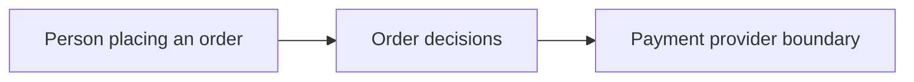

# Example store

Follow an order from draft to payment or cancellation. This is a small example,
with no real payment provider or database. Choose a box with a + to learn more.

The order code asks a payment provider for a reply. These boxes show parts that
work together. They are not steps in one state machine.
