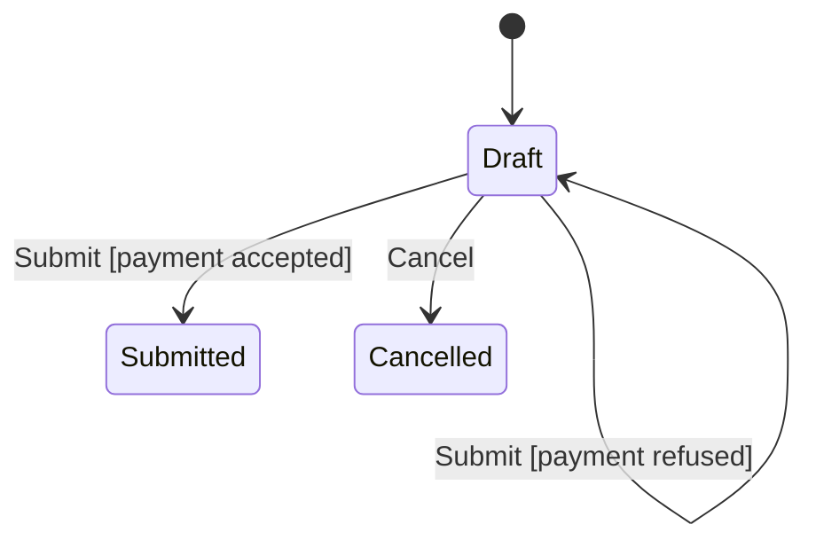
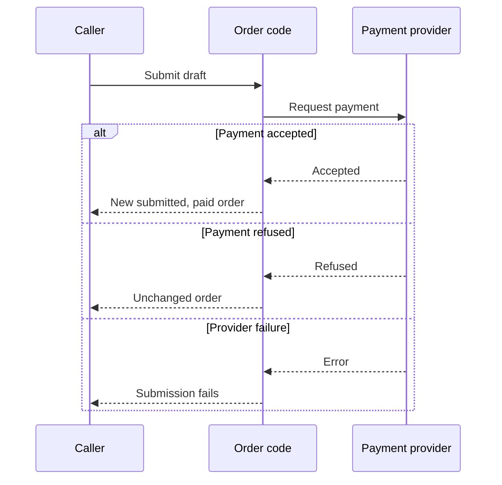

# Submit or cancel an order

A draft can be paid or cancelled. A submitted order cannot be cancelled here.
The code returns the updated order to its caller, who is responsible for saving it.
The chart starts with a draft supplied by the caller. This example does not create
or store orders itself.

## Draft order

Draft means the order has not been submitted or cancelled. Submission checks
this status before asking for payment. A submitted or cancelled order is returned
unchanged without another payment call.

This example checks the status, not the paid flag. The current value supplied by
the caller matters; there is no database lookup to find a newer copy.

## Payment accepted

An accepted payment reply produces a new order marked submitted and paid. The
original draft stays unchanged. Acceptance does not save the new order anywhere.

## Payment refused

A refused payment reply leaves the order unchanged. The caller can explain the
refusal to the person placing the order, but this source does not implement that UI.

If the provider throws an error, the submission also fails. That does not prove
no charge happened. The real provider is outside this example.

## Cancellation

Cancellation is allowed for a draft. It returns a new cancelled copy without
requesting payment. Trying to cancel a submitted or cancelled order raises an error.

## Who handles payment

## Limits of this example

Two calls using the same draft can both request payment. A safe retry policy and
storage are not included. Read the [source](../../src/orders.ts) for the complete
small implementation, and the [payment contract](payment-contract.md) for the
external boundary.
