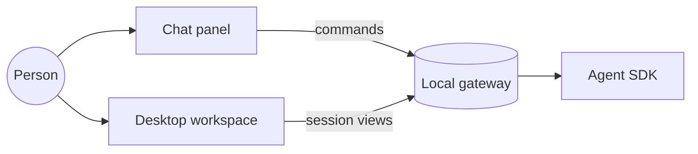

# Nessa system

This is a **temporary fixture** that follows the docs/state contract. Click a
service in the diagram to open it.

## Services

| Service | Owns | Status |
| --- | --- | --- |
| [Chat](services/chat/README.md) | Drafts, sends, history | implemented |
| [Desktop](services/desktop/README.md) | Workspace panes | mixed |
| [Gateway](services/gateway/README.md) | Conversation ownership | implemented |

## Reading conventions

Evidence links such as [the repository README](../../README.md) point at
repository files and are shown as evidence; sibling checkouts like
[nessa-ui](../../../nessa-ui/README.md) are outside-repo references.
