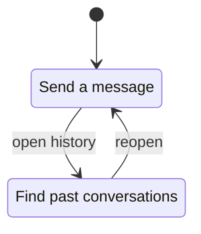

# Chat

## Features

- [Send a message](send/README.md) — draft to admitted input.
- [History](history/README.md) — search, archive, delete.

## Evidence

The [send-draft use case](../../../../src/conversation/send-draft.ts) and its
[tests](../../../../src/conversation/send-draft.test.ts#L1) own admission. A
[missing file](../../../../src/conversation/gone.ts) is flagged.
