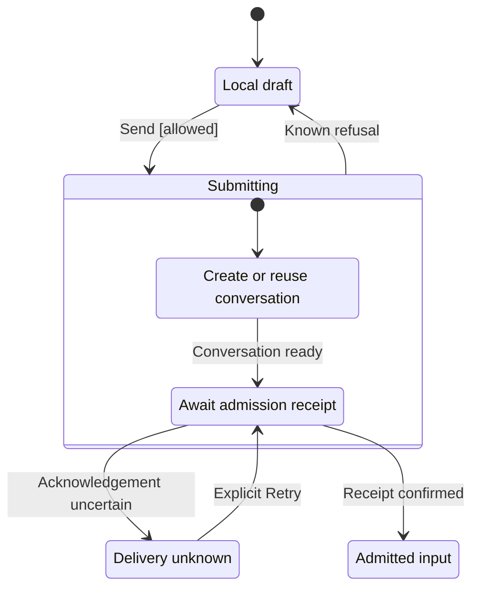

# First send lifecycle

## States



## Decisions and failure boundaries

Text is limited to 8 KiB. Raw HTML stays text: <script>alert("x")</script> and
.

### Bug-oriented evidence

- **Designed limitation:** the editor collapses before the round trip finishes.
- **Hypothesis:** send right after switching tabs.

## A broken diagram

```mermaid
flowchart LR
    A[unclosed --> B
```
