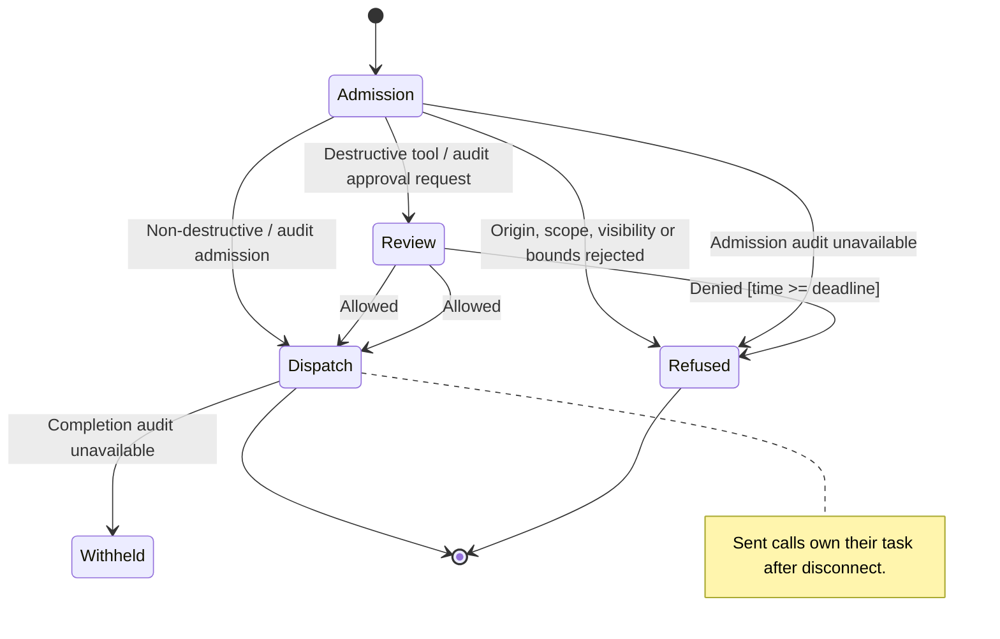
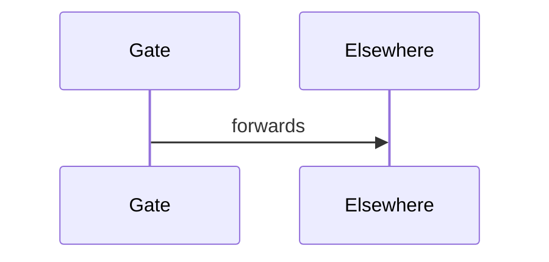

# Call gate

## States





```mermaid
stateDiagram-v2
    A -->
```

## Call admission

`Admission` means the gate is establishing who is asking. See the
[implementation](../../../src/gate.rs) and the [missing test](../../../src/gate.test.rs).

Second overview paragraph of admission; see [the refusal rules](#admission-refusal-rules).

Third paragraph, shown only in full.

## Admission refusal rules

`Refused` describes a call that did not reach the server.

- **Origin:** an untrusted origin is refused.
- **Scope:** another server is refused.

### Bounds

Nested bounds rule: arguments over 32 KiB are refused.

Evidence: [review flow](review.md), [web](https://example.com/spec),
[bad](javascript:alert(1)) and raw <script>window.__pwned = 1</script> text.

## Direct dispatch admission

The audit must commit before the call is sent; otherwise it is refused.

## Destructive review

A destructive call waits for a person.

## Review refusal

Denied once the deadline has passed.

## Notes

First notes heading.

## Notes

Second notes heading.

## After

Text after every section.
