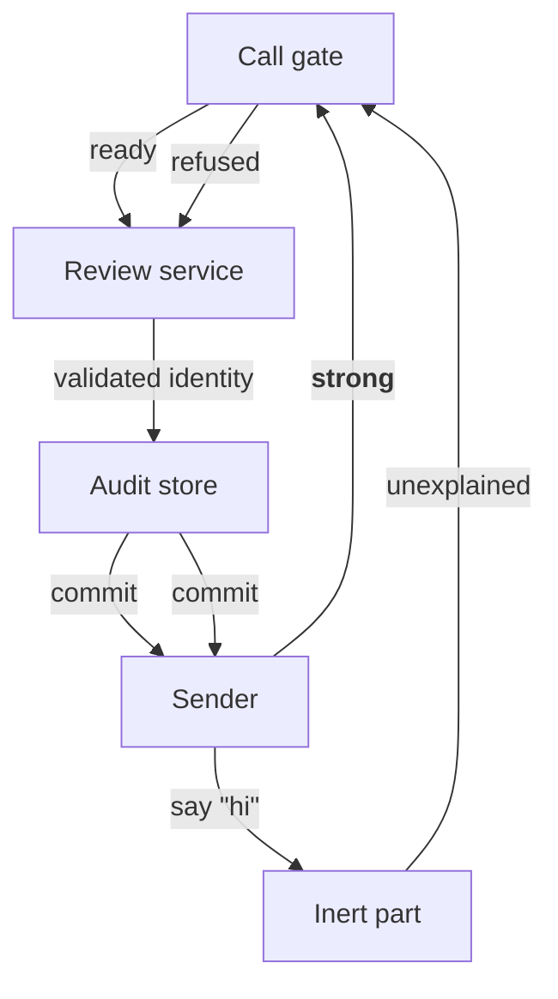

# Gate component map

The parts below work together. The arrows say what one part supplies to
another; they are not states.

## Gate readiness

The gate is ready once its dependencies have answered.

## Gate refusal

The gate refuses a call it cannot admit.

## Checking the identity

The review service checks the identity before the audit store accepts it.

## Review service

The review service holds destructive calls for a person.
